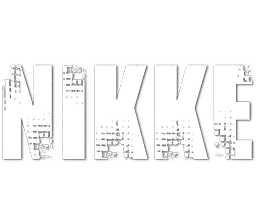

<div align="center">

# NIKKE Modding Wiki

**An open-source, community-driven, non-commercial modding hub for Goddess of Victory: NIKKE.**   Faster modding workflows, automated tools, character information, and archived legacy guides.

<br />

[](https://nikkemodding.rwyn.app)
[](https://github.com/rwynx/NIKKE-Modding-Wiki/releases)
[](LICENSE)
[](https://discord.gg/nikke)
<br />
<br>

_**Cosmetics only. We hate cheaters.**<br>
We respect SHIFT UP and their efforts to keep NIKKE's competitive integrity together. We do not<br> support, host or discuss cheats, damage modifiers, or stat hacks. Keep it visual and clean._

</div>
<br>
<p align="center" style="display: flex; justify-content: center; align-items: center; gap: 30px;">
  &nbsp;&nbsp;&nbsp;&nbsp;
  " alt="Nikke Logo">
</p>

## Table of Contents
- **[Overview](#overview)**
- **[Features](#features)**
- **[Stack & Local Setup](#stack--local-setup)**
- **[Contributing](#contributing)**
- **[Credits & Acknowledgement](#credits--acknowledgement)**
- **[Note to Publishers](#note-to-publishers)**
- **[LICENSE](#license)**

## Overview

Welcome to NIKKE Modding Wiki.  This wiki provides documented workflows and guides to make modding accessible for both casual users wanting cosmetic swaps and creators developing custom models or Spine animations.

---

## Features

- **Modern & Quick Modding:**
  - Workflows for automated tools and managers like **NMM** and **NMA** using non-destructive symlinks.
- **Video Guides & Legacy Archive:**
  - Step-by-step guides covering character swaps, physics adjustments and legacy manual methods.
- **Live Character List:** 
  - Instant-search database of 206+ characters and their internal identifiers (`c010`, `c220`, etc.), synced with **NKAS**.
- **Video Lab:**
  - We have a small video lab covering the initial setup, tool guides and mod creation. Currently provides 5 videos. *From Seireiko, Nix and Lady.*
- **Troubleshooting:** 
  - Quick-reference fixes for common issues like pink textures, directory sync errors or patch migrations.


---

## Stack & Local Setup

Built with React 18, Vite, TypeScript, and Tailwind CSS.

```bash
# 1. Clone the repository
git clone https://github.com/rwynx/NIKKE-Modding-Wiki.git
cd NIKKE-Modding-Wiki

# 2. Install dependencies
npm install

# 3. Start local development server
npm run dev
```

Build for production:

```bash
npm run build
```

---

## Contributing

Contributions, typo fixes, updated character IDs, and new modding guides are welcome.

1. Fork the repository.
2. Create your branch (`git checkout -b feature/new-guide`).
3. Commit your changes (`git commit -m "Add guide for ..."`).
4. Push to your fork and submit a Pull Request.

---

## Credits & Acknowledgement

Current wiki was built and is maintained by **[Rwyn](https://github.com/rwynx)**.<br>

Thanks **Lady** for compiling the legacy modding guides (moved from the old wiki).<br>
Thanks **Nix** for compiling the guide for modern modding tools.<br>
Thanks **Skuqre**, live character sync uses **NKAS.**

Doro Posing/Dancing artwork by **[@Moongzzi_S2](https://x.com/Moongzzi_S2/status/1854472104646992121)**

And special thanks to all great minds! Tool authors, engineers and community curators who made modding possible in the first place. You can see the full list of contributors in the **[CREDITS](https://nikkemodding.rwyn.app/#credits)** section on the live site.
> Gemini assisted in UI layout and Vite & React optimizations.<br>As of Beta 1.2, Gemini DeepMind's total contributions:<br>**861 lines - around %8** of the current codebase.


---

## Note to Publishers

We have massive respect for SHIFT UP and Level Infinite! We love NIKKE and built this wiki purely out of passion for the game and its creative community. 

This is a strictly non-commercial, fan-operated educational project. If you are a representative of **SHIFT UP or Level Infinite** and have concerns regarding any material documented here, please reach out to us at **[support@rwyn.app](mailto:support@rwyn.app)** or by opening an issue. We will gladly and promptly comply by taking down or adjusting any requested content without hesitation.

## License

This project is open-source under the [MIT License](LICENSE).

All game assets, logos, character likenesses, and registered trademarks belong to **SHIFT UP Corporation and Level Infinite**. 
